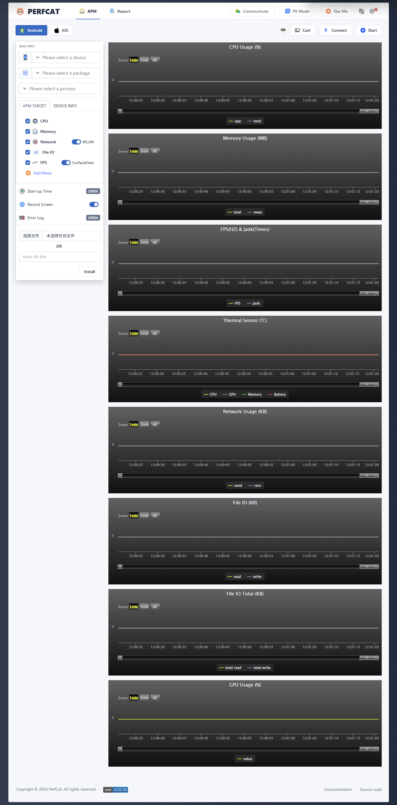

<p align="center">
  <a>中文</a> | <a href="./README.md">English</a> | <a href="./FAQ.md">FAQ</a> | <a href="https://mp.weixin.qq.com/s?__biz=MzkxMzYyNDM2NA==&mid=2247484506&idx=1&sn=b7eb6de68f84bed03001375d08e08ce9&chksm=c17b9819f60c110fd14e652c104237821b95a13da04618e98d2cf27afa798cb45e53cf50f5bd&token=1402046775&lang=zh_CN&poc_token=HKmRi2WjP7gf9CVwvLWQ2cRhrUR3wmbB9-fNZdD4" target="__blank">使用文档</a>
</p>

<p align="center">
<a href="#">

</a>
<br>
<b>性能牛 · PerfCattle</b>
</p>
<p align="center">
<a href="https://pypi.org/project/perfcattle/" target="__blank"></a>
<a href="https://pepy.tech/project/perfcattle" target="__blank"></a>
<br>
</p>

## 🔎简介

性能牛（PerfCattle）是一个可以实时收集Android/iOS性能数据的web工具。

快速定位分析性能问题，提升应用的性能和品质。无需ROOT/越狱，即插即用。



## 📦环境

- 安装 Python 3.10 + [**Download**](https://www.python.org/downloads/)
- 安装 adb和配置好环境变量 (PerfCattle自带的adb不一定适配你的电脑，建议自己安装) [**Download**](https://developer.android.com/studio/releases/platform-tools)

💡 如果Windows用户需要测试iOS，请先安装Itunes. [**参考**](https://github.com/alibaba/taobao-iphone-device)  （不支持iOS17）

## 📥安装

### 默认

```shell
pip install -U perfcattle (指定版本：pip install perfcattle==版本)
```

### 镜像

```shell
pip install -i  https://mirrors.ustc.edu.cn/pypi/web/simple -U perfcattle
```

💡 如果你的网络无法通过 [pip install -U perfcattle] 下载, 可以尝试使用镜像下载，但是可能不是最新版本.

## 🚀启动

### 默认

```shell
python -m perfcattle
```

### 自定义

```shell
python -m perfcattle --host={ip} --port={port}
```

### 日志文件

PerfCattle 默认会把运行日志写入当前目录的 `logs/perfcattle.log`，控制台只输出错误日志。

```shell
python -m perfcattle --log_file=/path/to/perfcattle.log
```

## 🏴󠁣󠁩󠁣󠁭󠁿使用python收集

```python
# perfcattle version : >= 2.9.0
from perfcattle.service.monitor import AppPerformanceMonitor
from perfcattle.device.manager import Devices

d = Devices()
processList = d.getPid(deviceId='ca6bd5a5', pkgName='com.bilibili.app.in') # for android
print(processList) # ['{pid}:{packagename}',...]，一个app可能会有多个进程，如果需要指定pid，可以从这里获取

apm = AppPerformanceMonitor(pkgName='com.bilibili.app.in',platform='Android', deviceId='ca6bd5a5', surfaceview=True, 
                            noLog=False, pid=None, record=False, collect_all=False)
# apm = AppPerformanceMonitor(pkgName='com.bilibili.app.in', platform='iOS')
# surfaceview： 为False时是使用gfxinfo方式，需要在手机上设置：(手机开发者 - GPU渲染模式 - adb shell dumpsys gfxinfo) 不推荐使用这种方式
# noLog : False (保存测试数据到log文件中)

# ************* 收集单个性能参数 ************* #
cpu = apm.collectCpu() # %
memory = apm.collectMemory() # MB
memory_detail = apm.collectMemoryDetail() # MB
network = apm.collectNetwork(wifi=True) # KB，wifi=False 时读取移动数据接口流量
fps = apm.collectFps() # HZ
battery = apm.collectBattery() # level:% temperature:°C current:mA voltage:mV power:w
gpu = apm.collectGpu() # % 安卓只支持高通芯片的手机
disk = apm.collectDisk() # KB
thermal = apm.collectThermal() #温度传感器，收集各个部件的温度（一些手机可能没有权限）

# ************* 收集所有性能参数 ************* #
 
if __name__ == '__main__':  #必须要在__name__ == '__main__'里面执行
  apm = AppPerformanceMonitor(pkgName='com.bilibili.app.in',platform='Android', deviceId='ca6bd5a5', surfaceview=True, 
                              noLog=False, pid=None, record=False, collect_all=True, duration=0)
  # apm = AppPerformanceMonitor(pkgName='com.bilibili.app.in', platform='iOS',  deviceId='xxxx', noLog=False, record=False, collect_all=True, duration=0)
  #duration: 执行时长（秒），只有>0的时候才生效，=0时会持续执行
  #record: 是否录制
  apm.collectAll(report_path=None) # report_path='/test/report.html', None则保存在默认路径

# 在另外的python脚本中可以主动终止perfcattle服务，无需等待设置的执行时长结束
from perfcattle.service.monitor import AppPerformanceMonitor

AppPerformanceMonitor.stop()
```

## 🏴󠁣󠁩󠁣󠁭󠁿使用API收集

### 后台启动服务

```
# perfcattle version >= 2.8.7

macOS/Linux: nohup python3 -m perfcattle &
Windows: start /min python3 -m perfcattle &
```

### 通过api请求数据

```shell
Android: http://{ip}:{port}/apm/collect?platform=Android&deviceid=ca6bd5a5&pkgname=com.bilibili.app.in&target=cpu
iOS: http://{ip}:{port}/apm/collect?platform=iOS&pkgname=com.bilibili.app.in&target=cpu

target in ['cpu','memory','memory_detail','network','fps','battery','gpu']
```

## 🔥功能

* **无需ROOT/越狱:** Android设备无需ROOT，iOS设备无需越狱。高效解决Android & iOS性能测试分析难题。
* **数据完整性:** 可提供FPS、Jank、CPU、GPU、Memory、Battery 、Network、Disk等性能参数，这些您都可以轻松获得。
* **美观的报告看板:** 报告看板，您可以随时随地存储、可视化、编辑、管理和下载使用任何版本的PerfCattle收集的所有测试数据。
* **好用的监控设置:** 支持在监控过程中设置告警值、收集时长、访问其他PC机器的移动设备。
* **比对模式:** 支持两台移动设备同时对比测试。

  - 🌱2-devices: 使用两台不同的设备测试同一个app。
  - 🌱2-apps: 使用两台配置相同的设备测试两个不同的app。
* **多报告对比:** 在测试报告页勾选 2–6 份同 App、同平台的正常报告即可进入对比页；摘要表按场景展开，多指标图表拆成独立曲线表，每个场景一条曲线。
* **API收集性能数据:** 支持python、API收集性能数据，帮助用户轻松集成在CI/CD流程。
* **Unity 采集:** 在 APM 会话中同时录制 Unity Profiler / MemoryProfiler 原始数据；优先使用工程内脚本，未集成时自动回退到 PlayerConnection 协议（已验证 Unity 2022.3，无需改游戏）。原始文件归档在 `report/<scene>/unity/`，测试报告页导出时会与性能数据、离线 JSON 一起打包。
* **Unity Profiler 离线 JSON:** 导出报告时自动把 `profiler.raw` 转成 JSON（帧耗时、线程耗时、热点 marker、GC 分配、最慢帧调用树），无 Unity 环境也能分析。
* **对比报告导出:** 对比页可导出 ZIP，内含 `compare.xls` / `compare.json` 对比汇总，以及每份报告的原始 Excel、元信息、Unity Profiler 离线 JSON、`.raw` / `.snapshot` 二进制文件。
* **Deep Profiler / Profiler Modules:** 像 Unity Profiler 一样勾选要采集的 Module，并支持 Deep Profiler 开关；协议模式下可在采集中热切换（Deep Profiler 需构建时开启 Deep Profiling Support）。
* **Unity 游戏面板:** Protocol 模式直接解析原始 Profiler 流（Unity 2022.2+），也可选用工程内脚本；显示 CPU/GPU 帧耗时、Draw Calls、SetPass Calls、Batches、三角面、顶点数、GC Alloc、已用内存，以及 Render Textures、Used Buffers、顶点/索引缓冲上传（数量 + 内存），并与系统 CPU 按同一时间轴写入报告和对比分析。
* **Unity 热点函数:** 在报告分析页按帧查看 Timeline（按线程的采样色块）、Hierarchy（合并调用路径的 Total/Self/Calls/GC）和 Raw Hierarchy（不合并），支持线程选择与排序。
* **Unity 采集技术文档:** [docs/UNITY_CAPTURE.md](docs/UNITY_CAPTURE.md) — 已支持的 PlayerConnection 版本、线协议格式、Area→Category 映射，以及新增 Unity 版本 / Profiler 功能的扩展清单。

## 浏览器


## 终端

- windows: PowerShell
- macOS：iTerm2 (https://iterm2.com/)

## 💕感谢

- https://github.com/alibaba/taobao-iphone-device
- https://github.com/Genymobile/scrcpy

## 联系

关注公众号，直接发私信，作者看到就回复


